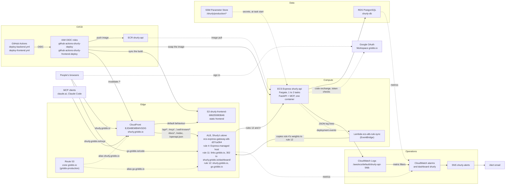
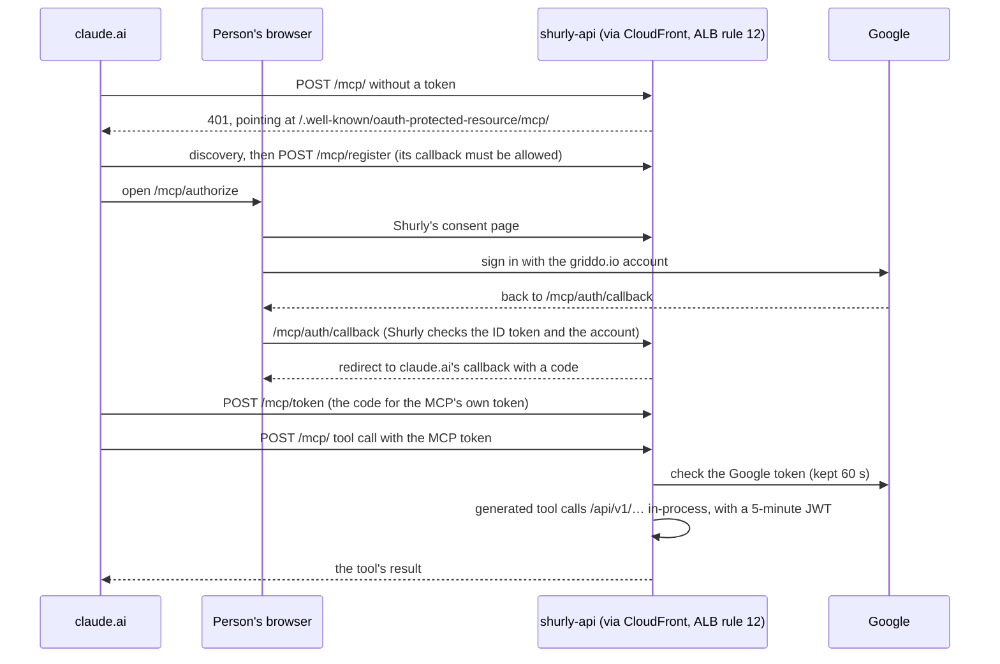

# Shurly's architecture in production

What runs where, and how a request gets through it. Everything below is in AWS account **griddo-main**
(`686255983646`), region **eu-south-2**, except the DNS zone, which is in **griddo-production** (`253490783612`).

- How to build and operate each piece: [DEPLOYMENT.md](../DEPLOYMENT.md), and the playbook
  [docs/AWS_ECS_DEPLOYMENT.md](AWS_ECS_DEPLOYMENT.md) (lessons, troubleshooting, decision log).
- The data model: [docs/DATABASE_SCHEMA.md](DATABASE_SCHEMA.md).

## The diagram

`shurly.griddo.io` goes through CloudFront; `go.griddo.io` goes straight to the ALB. Both end at the same service
through rule 12, and the `Host` header tells the app which one was asked
([DEPLOYMENT.md § Architecture](../DEPLOYMENT.md#architecture)).

## The boxes

### Edge

**Route 53.** The `griddo.io` hosted zone (`Z0999097TJGECCBKJOY1`) lives in the other account, griddo-production,
inherited from Griddo's existing setup. `shurly.griddo.io` is an alias to the CloudFront distribution, `go.griddo.io`
an alias to the ALB, and the ACM validation CNAMEs are there too. Every write is an explicit cross-account call
(`--profile griddo-production`), with no cross-account IAM role.
Documented in [DEPLOYMENT.md § Architecture](../DEPLOYMENT.md#architecture),
[§ 5. Custom domain](../DEPLOYMENT.md#5-custom-domain-gogriddoio) and
[AWS_ECS_DEPLOYMENT.md § Why two AWS accounts](AWS_ECS_DEPLOYMENT.md#why-two-aws-accounts-service-vs-dns).

**CloudFront distribution** (`EJDA8EMBWVGDG`, live since 2026-09-29). It puts the web app and the API on one host,
`shurly.griddo.io`, so the browser makes no cross-origin calls and production needs no CORS entry. The default
behaviour serves the static build from S3 (cached, with the `shurly-static-paths` function resolving directory
indexes and the `shurly-security-headers` policy). The API's paths go to the ALB uncached: `/api/*`, `/mcp*`,
`/.well-known/*`, `/docs*`, `/redoc` and `/openapi.json`. On those, CloudFront forwards the viewer's `Host`, adds
`CloudFront-Viewer-Address`, and adds the secret header `X-Origin-Verify`, so the app can trust the client IP it
reads. Its certificate is in us-east-1, as CloudFront requires.
Documented in [DEPLOYMENT.md § Frontend hosting](../DEPLOYMENT.md#frontend-hosting-phase-410),
[§ The distribution](../DEPLOYMENT.md#the-distribution) and
[§ Client IPs behind CloudFront](../DEPLOYMENT.md#client-ips-behind-cloudfront-phase-63).

**S3 bucket `shurly-frontend-686255983646`.** Holds the Astro static build (`frontend/dist/`). It's private: Block
Public Access on, no website hosting, readable only by the distribution through Origin Access Control
(`shurly-frontend-oac`). Hashed `_astro/` files are cached for a year; pages revalidate on every load.
Documented in [DEPLOYMENT.md § The bucket](../DEPLOYMENT.md#the-bucket) and
[§ The deploy role](../DEPLOYMENT.md#the-deploy-role).

**ALB `ecs-express-gateway-alb-d37ca364`.** ECS Express created it for Shlink, and Shurly reused it; since
Shlink's removal Shurly is the only service behind it. Its HTTPS listener carries the ACM certificates (eu-south-2)
for the custom hosts. Three rules matter:
- **rule 4**, managed by ECS Express: its own `sh-<hex>.ecs.eu-south-2.on.aws` host, forwarding to the service's
  active target group;
- **rule 11**, `links.griddo.io` (Shlink's old web client): a 302 to `https://shurly.griddo.io/dashboard/`, answered
  by the ALB itself;
- **rule 12**, `shurly.griddo.io` and `go.griddo.io`: forwards to the service, with the weights the rule-sync Lambda
  copies from rule 4.

Its address is inside the default VPC (`172.31.0.0/16`), which is what `TRUSTED_PROXIES` names, so the app reads
`X-Forwarded-For` from it on `go.griddo.io`.
Documented in [DEPLOYMENT.md § Architecture](../DEPLOYMENT.md#architecture),
[§ 5. Custom domain](../DEPLOYMENT.md#5-custom-domain-gogriddoio) and
[§ Trusted-Proxy Configuration](../DEPLOYMENT.md#trusted-proxy-configuration).

### Compute

**ECS Express service `shurly-api`** (cluster `default`, Fargate, x86_64, 0.25 vCPU and 0.5 GB, 1 to 2 tasks). One
container runs uvicorn on port 8000 with everything: the redirects, the API under `/api/v1/`, and the MCP mounted
at `/mcp` in the same process. The health check is `GET /api/v1/health`. Pending Alembic migrations run at startup.
The geolocation databases are baked into the image, so a visit's place is looked up in process, with no network
call. Deploys are blue/green between two target groups, with a canary of about 10 to 12 minutes.
Documented in [DEPLOYMENT.md § 4. ECS Express service](../DEPLOYMENT.md#4-ecs-express-service),
[§ Routine operations](../DEPLOYMENT.md#routine-operations),
[§ Geolocation data](../DEPLOYMENT.md#geolocation-data-phase-84) and
[AWS_ECS_DEPLOYMENT.md § Architecture in one diagram](AWS_ECS_DEPLOYMENT.md#architecture-in-one-diagram).

**Lambda `ecs-alb-rule-sync`.** ECS Express shifts traffic between its two target groups on its own rule (4), and
doesn't touch the custom rule (12). Without this Lambda, rule 12 would point at the old target group after a deploy
and both hosts would answer 503. The EventBridge rule `ecs-deploy-alb-sync` fires it on ECS deployment state changes;
it follows a rollout from `IN_PROGRESS`, syncing every 5 seconds. Its map holds rule 4 → 12 alone since the
cutover; rule 11, a redirect, isn't in it, and a mapped rule that redirects would be skipped.
Its source is [infra/ecs-alb-rule-sync/](../infra/ecs-alb-rule-sync/README.md).
Documented there and in [DEPLOYMENT.md § 6. Extend the ALB rule-sync Lambda](../DEPLOYMENT.md#6-extend-the-alb-rule-sync-lambda).

### Data

**RDS PostgreSQL `shurly-db`** (db.t4g.micro, PostgreSQL 17, 20 GB gp3, encrypted, no public access). Every link,
visit, campaign, account and the MCP's OAuth state (`mcp_oauth_store`, encrypted) live here, so both tasks and every
deploy share them; the rate-limit counters too. It sits in the default VPC, in the `shlink-db-subnets` subnet group
inherited from Shlink, behind `shurly-db-sg` (5432 open within the VPC only). Automated backups are kept 7 days.
Documented in [DEPLOYMENT.md § 1. RDS PostgreSQL](../DEPLOYMENT.md#1-rds-postgresql) and
[§ Backup and recovery](../DEPLOYMENT.md#backup-and-recovery);
the tables in [docs/DATABASE_SCHEMA.md](DATABASE_SCHEMA.md).

**SSM Parameter Store, `/shurly/production/*`.** The five secrets, as `SecureString` (standard tier, key
`alias/aws/ssm`): `DB_PASSWORD`, `JWT_SECRET_KEY`, `GOOGLE_CLIENT_SECRET`, `MCP_OAUTH_SIGNING_KEY` and
`CLOUDFRONT_ORIGIN_SECRETS`. The container lists their ARNs in `secrets`; ECS reads them with the execution role
(`ecsTaskExecutionRole`, inline policy `shurly-read-parameters`) when a task starts, so a new value needs a redeploy.
No value appears in the task definition, a deploy log or `describe-*`. Parameter Store over Secrets Manager because
it's free and rotation wouldn't help an app that reads secrets once.
Documented in [DEPLOYMENT.md § Secrets](../DEPLOYMENT.md#secrets-phase-63).

### Operations

**CloudWatch Logs, `/aws/ecs/default/shurly-api-5fdb`** (60 days). The app writes one JSON line per request
(`http.request`) and named events (`auth.login`, `mcp.tool_call`, `client.error`, …), never an IP or a token. The
one-off tasks (imports, backfills) write to the same group.
Documented in [DEPLOYMENT.md § Error alerting](../DEPLOYMENT.md#error-alerting-phase-64) and
[§ View logs](../DEPLOYMENT.md#view-logs).

**CloudWatch alarms and the dashboard `shurly`.** Four metric filters (namespace `Shurly`) turn log lines into
counts; six alarms watch them and the ALB's and RDS's own metrics (5xx from the app, rate-limit store failures,
browser errors, ALB 5xx, no healthy target, low database storage). The dashboard shows ECS, ALB, RDS, the app's
metrics, redirect latency and MCP-vs-API latency. All of it is defined in [infra/monitoring/](../infra/monitoring/)
and applied by `scripts/setup_monitoring.sh`, never the console.
Documented in [DEPLOYMENT.md § The alarms](../DEPLOYMENT.md#the-alarms) and
[§ The dashboard](../DEPLOYMENT.md#the-dashboard).

**SNS topic `shurly-alerts` → email.** Each alarm emails its subscribers when it fires and when it's back to OK.
Documented in [DEPLOYMENT.md § The email](../DEPLOYMENT.md#the-email).

### CI/CD

**GitHub Actions.** `deploy-backend.yml` runs on every push to `main` (branch-protected), every Monday at 05:00 UTC
(to rebuild with that week's geolocation data) and by hand. It builds the image, pushes it to ECR, and sends the live
container back with only its image changed, so settings and secrets survive. `deploy-frontend.yml` runs on merges to
`main` that touch `frontend/**`: it builds, syncs `frontend/dist/` to the bucket and invalidates `/*`. `test.yml` is
CI and deploys nothing.
Documented in [DEPLOYMENT.md § CI/CD with OIDC](../DEPLOYMENT.md#cicd-with-oidc) and
[§ Workflow trigger](../DEPLOYMENT.md#workflow-trigger).

**IAM OIDC roles.** No access keys: GitHub's identity token is exchanged with STS for a role. The backend role,
`github-actions-shurly-deploy`, trusts the GitHub environment `production` (which allows `main` only) and may push to
`shurly-api` and update the service. The frontend role, `github-actions-shurly-frontend-deploy`, trusts
`refs/heads/main` and may write that one bucket and invalidate that one distribution.
Documented in [DEPLOYMENT.md § CI/CD with OIDC](../DEPLOYMENT.md#cicd-with-oidc) and
[§ The deploy role](../DEPLOYMENT.md#the-deploy-role).

**ECR repository `shurly-api`.** Private, with scan on push and immutable tags (`<sha>-<timestamp>`). A lifecycle
rule expires images older than 30 days, since each holds that week's GeoLite2 copy (its licence's 30 days); a
rollback within 30 days still works.
Documented in [DEPLOYMENT.md § 4. ECS Express service](../DEPLOYMENT.md#4-ecs-express-service) and
[§ Geolocation data](../DEPLOYMENT.md#geolocation-data-phase-84).

### Outside AWS

**People's browsers.** They load the web app from `shurly.griddo.io` and follow short links on `go.griddo.io`.

**MCP clients.** claude.ai custom connectors and Claude Code connect to `https://shurly.griddo.io/mcp/`. They sign in
through the MCP's OAuth proxy (with Google) or send an API key. claude.ai calls the OAuth endpoints from Anthropic's
servers; Claude Code from the person's machine, with a loopback redirect.
Documented in [DEPLOYMENT.md § The MCP](../DEPLOYMENT.md#the-mcp-phase-58),
[docs/setup_mcpclient.md](setup_mcpclient.md) and [mcp_server/README.md](../mcp_server/README.md).

**Google OAuth.** A Google Cloud project in the griddo.io organization, with an Internal consent screen and one Web
client. Its two redirect URIs are the web sign-in's (`/api/v1/auth/google/callback`) and the MCP proxy's
(`/mcp/auth/callback`). Only accounts whose Workspace domain is `griddo.io` get in. Its client secret is in Parameter
Store.
Documented in [DEPLOYMENT.md § Sign in with Google](../DEPLOYMENT.md#sign-in-with-google-phase-313) and
[docs/setup_google_app.md](setup_google_app.md).

## The request paths

### A short link on go.griddo.io

1. Route 53 resolves `go.griddo.io` to the ALB. CloudFront isn't on this path.
2. The ALB matches rule 12 on the `Host` and forwards to the service's active target group.
3. The app takes the client IP from `X-Forwarded-For`, as the ALB is a trusted proxy, and finds the link by host and
   code.
   - Unknown code: an orphan visit is logged and the answer is a 404.
   - Not yet valid: 404. Expired or past its visit cap: 410.
4. The redirect rules pick the destination (device, language, query parameter, date, browser); a campaign link adds
   its recipient's data.
5. A social media crawler gets the same redirect, without any recipient's data, and reads the destination page's own
   Open Graph tags. If the link overrides its preview, it gets Shurly's preview page with those tags instead. A
   crawler's request isn't logged as a visit.
6. Anyone else (unless `?nostat`): the visit is written to RDS with the IP anonymized (IPv4 /24), its country and city
   from the in-image database, and the bot flag.
7. The answer is a 302 with `Cache-Control: private, max-age=0`.

### Loading the web app on shurly.griddo.io

1. Route 53 resolves `shurly.griddo.io` to the CloudFront distribution.
2. A page path falls to the default behaviour. The `shurly-static-paths` function adds `index.html` to a path ending
   in `/`, leaves a file (a dot in its last segment) as it is, and answers 301 to the path with its slash otherwise.
3. CloudFront serves from its cache or fetches from the S3 bucket through OAC, and adds the security headers. The
   Content-Security-Policy ships in each page's `<meta>`.
4. Signing in: the page sends the browser to `/api/v1/auth/google/start` → Google → `/api/v1/auth/google/callback`
   → `/login/#code=…`, and the page exchanges the one-time code at `/api/v1/auth/google/exchange` for the API's JWT.

### An API call from the web app

1. The page calls `https://shurly.griddo.io/api/v1/…` with `Authorization: Bearer <JWT>`. Same origin: no CORS.
2. CloudFront's `/api/*` behaviour, uncached, forwards it to the ALB over HTTPS with the viewer's `Host`,
   `CloudFront-Viewer-Address` and `X-Origin-Verify`.
3. The ALB matches rule 12 and forwards to the service.
4. The app checks `X-Origin-Verify` against `CLOUDFRONT_ORIGIN_SECRETS` and only then takes the client IP from
   `CloudFront-Viewer-Address` (for the rate limits), verifies the JWT, and reads or writes RDS.
5. It logs one `http.request` line to CloudWatch, which the metric filters count.

### An MCP tool call from claude.ai

1. Every request goes to `shurly.griddo.io` through CloudFront's `/mcp*` and `/.well-known/*` behaviours, then ALB
   rule 12.
2. The OAuth state (registration, sign-in in progress, codes, Google's tokens) is stored encrypted in RDS
   (`mcp_oauth_store`), so either task can answer any step.
3. A generated tool calls the FastAPI app in the same process (an HTTP client over the ASGI app, no network), with a
   short-lived JWT for the account. That call gets its own `http.request` line, and the tool its `mcp.tool_call`.
4. An API key works instead of the OAuth sign-in, sent as the bearer.

## What isn't here

Shlink: removed 2026-10-17, with its import bucket and task role; its ALB rule 10 went at the cutover (2026-10-02),
and rule 11 is now a redirect. `s.griddo.io`: deleted 2026-10-02, with its links, certificate and DNS record. Nor
Secrets Manager (Parameter Store instead) or Lambda@Edge (no custom error pages).
