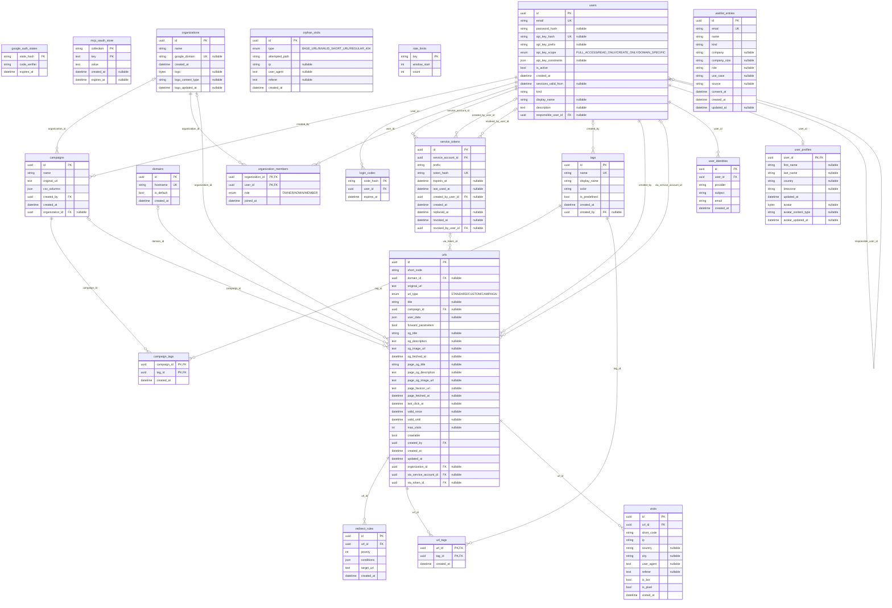

# Database schema

Shurly keeps everything in one PostgreSQL database. The diagram below is generated from the SQLAlchemy models in
`server/core/models/`, so it shows what the code expects; the schema itself is created and changed by the Alembic
migrations in `server/migrations/versions/`, which the app runs when it starts.

## The tables

- **`users`** — accounts: people, and service accounts (`kind`) with the person responsible for them. Holds the
  password and API key hashes. **`user_profiles`** — a person's names, country, time zone and avatar, one row per user.
- **`user_identities`** — an account at an identity provider (Google), by the provider's subject.
  **`google_auth_states`** and **`login_codes`** — a Google sign-in in progress, and the one-time code the callback
  hands to the frontend. Both short-lived and stored hashed.
- **`organizations`** and **`organization_members`** — the organization (its logo, the Google domain that joins it)
  and each member's role: owner, admin or member.
- **`domains`** — the hostnames short links are served from; one is the default.
- **`urls`** — the short links: standard, custom or campaign, with their validity window, visit cap, previews and who
  made them (a person, or a service account and its token). A short code is unique per domain.
- **`visits`** — one row per click on a short link, with the anonymized IP, place, user agent and the bot and pixel
  flags. **`orphan_visits`** — requests for short codes that don't exist.
- **`campaigns`** — a CSV-driven batch of personalized links (`urls.campaign_id`).
- **`tags`**, **`url_tags`** and **`campaign_tags`** — labels, and which links and campaigns carry them.
- **`redirect_rules`** — a link's conditional redirects, evaluated by priority before the default destination.
- **`service_tokens`** — a service account's tokens, kept as hashes, with renewal and revocation.
- **`waitlist_entries`** — people outside Griddo who asked for Shurly.
- **`rate_limits`** — rate-limit counters, one row per key, shared by every task.
- **`mcp_oauth_store`** — what the MCP's OAuth proxy keeps between requests (client registrations, codes, tokens),
  as key-value rows per collection.

## Regenerating the diagram

After changing a model (and writing its migration):

```bash
uv run python scripts/generate_schema_diagram.py           # rewrites the block below
uv run python scripts/generate_schema_diagram.py --check   # exits 1 if it's out of date
```

`tests/test_schema_diagram.py` fails while the block differs from what the models generate. Don't edit the block by
hand.

Reading it: each column is `type name keys "notes"`, where the keys are `PK` (primary key), `FK` (foreign key) and
`UK` (unique on its own), and the notes give an enum's values and whether the column is nullable. Each relationship
is labeled with its foreign-key column; `|o` on the parent side means that column is nullable, and `o|` on the child
side means at most one child per parent.

## Diagram

<!-- schema:begin -->

<!-- schema:end -->
